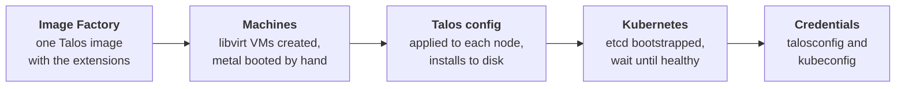

# k8s-infra

k8s-infra builds my Talos Linux Kubernetes clusters with OpenTofu. One `tofu apply` creates the virtual machines, installs Talos on them, starts Kubernetes and waits until the cluster is healthy. The `lab` cluster runs as VMs on [chibang](https://github.com/edy-rus/chibang), my home server.

The one idea to hold on to: **the cluster is described, not assembled.** Every node, version and setting is in this repo. Changing a version number and applying it upgrades the cluster, and a broken node can be wiped and rebuilt from the same code.

This repo stops at "the cluster is up". The apps that run on it will live in a separate `k8s-gitops` repo, managed by Argo CD (see ROADMAP.md). For the story of why Kubernetes runs in VMs instead of on the server itself, see the write-up [Chibang - A GitOps-Managed Home Server for Kubernetes](https://edy.tarbide.com/projects/gitops-managed-home-server/).



Each box is one layer in `envs/<env>/main.tf`, and each layer depends on the one before it.

## The Foundations

| Piece | What it is | What it gives this repo |
|---|---|---|
| **Talos Linux** | An OS that only runs Kubernetes. No shell and no SSH, everything is an API call | Nodes that cannot drift by hand, configured from one YAML document per node |
| **Image Factory** | Sidero's service that builds Talos images with chosen extensions | The ISO and installer image, both from the same recipe (a "schematic") |
| **OpenTofu** | The open-source fork of Terraform | Declares VMs and Talos config together, with encrypted state |
| **libvirt provider** | Talks to libvirt on the VM host over SSH | Creates the disk pool, disks and VMs |
| **Talos provider** | Talks to the Talos API on each node | Generates secrets and config, applies them, bootstraps and upgrades the cluster |

## The Repo, File by File

```
modules/
  libvirt-vm/          VMs on a libvirt host: disk pool, ISO, disks, UEFI/Secure Boot
  talos-cluster/       Talos secrets, config, install, bootstrap, upgrades, health, kubeconfig
    templates/node.yaml.tftpl   per-node identity (install disk, hostname, taints)
envs/
  lab/                 cluster "lab": VMs on one libvirt host
    main.tf            the three layers, wired together
    variables.tf       every setting, with its default and validation
    terraform.tfvars.example   template for terraform.tfvars (host, versions, nodes)
    versions.tf        provider versions and state encryption
    outputs.tf         ISO URL, talosconfig, kubeconfig
    patches/           Talos config for all nodes, control planes or workers
    reset.sh           wipe one node back to a fresh install
  prod/                (planned) bare metal and a cloud VPS
```

### Environments

Each folder in `envs/` is its own OpenTofu project with its own settings, patches, encrypted state and cluster secrets. A mistake in `lab` cannot touch `prod`. A change is tried in `lab` first, then made the same way in `prod`.

### Nodes

`terraform.tfvars` holds this cluster's libvirt host, versions and nodes. It is gitignored, because it names real addresses on my network. Copy `terraform.tfvars.example` to start one.

Every node is one entry in its `nodes` map, keyed by its hostname:

| Field | Meaning |
|---|---|
| `role` | `controlplane` or `worker` |
| `platform` | `libvirt` creates a VM. `metal` means the machine is already booted from the ISO and waiting at `ip` |
| `ip` | The address from the router's DHCP reservation |
| `mac` | libvirt only. Fixed, so the DHCP reservation matches |
| `install_disk` | Where Talos installs (default `/dev/vda`) |
| `allow_workloads` | Control planes only. `true` (default) lets apps run there too |
| `vcpu`, `memory_mib`, `disk_gib` | libvirt only. VM size |

A VM and a bare-metal machine get exactly the same Talos config. The only difference is whether OpenTofu creates the machine.

## How a Node Comes Up

1. **Image.** The schematic (the list of extensions) is sent to the Image Factory, which returns a matching ISO and installer image. A new Talos version or extension list means a new image.
2. **VM.** The libvirt module creates a disk pool, uploads the ISO, and creates each VM with an empty disk and the ISO attached. The boot order is disk first, so an empty disk falls through to the ISO.
3. **Maintenance mode.** The ISO boots Talos into maintenance mode. It gets its IP from the DHCP reservation and waits for a config.
4. **Config.** The Talos module generates the cluster secrets once, builds each node's config (base config, then the `patches/` files, then the per-node template), and applies it to the node's IP.
5. **Install.** Talos installs itself to the disk using the installer image and reboots. From now on the disk boots and the ISO is ignored.
6. **Bootstrap.** etcd is started once, on the first control plane by name.
7. **Health.** `apply` waits until Kubernetes reports healthy, then writes out the kubeconfig. If `apply` finishes, the cluster works.

## Secure Boot

With `secure_boot = true` (the default), nodes use the Secure Boot versions of the ISO and installer, and the VMs boot with Secure Boot on.

- The VM firmware starts with Secure Boot on and **no keys enrolled** (setup mode). On first boot the Talos ISO enrolls the Image Factory's keys. From then on, only Talos images signed with those keys boot.
- Each VM is created with a fresh copy of the firmware variables, so old keys from an earlier VM cannot leak in.
- Never let libvirt pick its default firmware with Microsoft's keys. It rejects Talos images.
- If the boot menu stops at "Enroll Secure Boot keys", pick it once in the VM console.
- Turning Secure Boot on or off means reinstalling the node.

## Using It

Requirements:

- **OpenTofu 1.10 or later.** State encryption only exists in OpenTofu.
- **SSH to the libvirt host** through your ssh-agent. The provider uses `qemu+sshcmd://`, which runs your own `ssh` command. Not `qemu+ssh://`, because SELinux on Fedora blocks sshd from forwarding libvirt's socket.
- **libvirt access without a password prompt** for the SSH user (a polkit rule for `org.libvirt.unix.manage`, or the `libvirt` group). chibang ships this rule in its image.
- **DHCP reservations** for each VM's `mac` and `ip`.
- **A state passphrase** per environment (16 characters or more), kept in your password store.

Create or update the cluster:

```sh
cd envs/lab
cp terraform.tfvars.example terraform.tfvars   # first time only, then fill it in
export TF_VAR_state_passphrase="$(pass <your-entry>)"
tofu init
tofu plan -out tfplan
tofu apply tfplan    # finishes only when Kubernetes is healthy
```

Merge the admin credentials into your home configs instead of writing them into the repo:

```sh
tofu output -raw talosconfig > /tmp/talosconfig
talosctl config merge /tmp/talosconfig && rm /tmp/talosconfig   # context "lab"
talosctl -n <cp-ip> kubeconfig                                   # merges admin@lab
talosctl -n <cp-ip> dashboard
kubectl get nodes
```

## Day 2 - Changing the Cluster

Getting the cluster running is Day 1. Day 2 is everything after that: upgrades, new nodes, drift and repairs. Here each of those is a change to `terraform.tfvars` followed by `tofu apply`.

| To do this | Change | What happens |
|---|---|---|
| Upgrade Talos | `talos_version` | Each node is upgraded in place to the new installer image |
| Upgrade Kubernetes | `kubernetes_version` | Talos runs its Kubernetes upgrade across the cluster |
| Add an extension | `extensions` | New schematic, new image, nodes upgrade onto it |
| Add a node | a new entry in `nodes` (and a DHCP reservation) | A VM is created and joins the cluster |
| Keep apps off a control plane | `allow_workloads = false` | The control plane keeps its default "no apps here" taint |
| Check for drift | nothing, run `tofu plan` | Shows any node whose config no longer matches the repo |

### Wiping a Node

`envs/lab/reset.sh [node]` puts a node back to a fresh install while keeping the cluster secrets, so your existing talosconfig and kubeconfig keep working. It replaces exactly four things: the VM (fresh firmware, so Secure Boot keys enroll again), its disk, its Talos config, and the etcd bootstrap. Check the plan shows those four replacements, and never the machine secrets, before typing `yes`.

## State and Secrets

Each environment keeps its own `terraform.tfstate`. It is local, gitignored and encrypted with AES-GCM, using a key derived from the passphrase. Plans are encrypted too.

The state holds the cluster's certificate authority and admin credentials, so it is the most important file here:

- **Back up the state.** Losing it means losing admin access to the cluster.
- **Back up the passphrase.** Without it the state cannot be read.
- `talosconfig` and `kubeconfig` are gitignored. Regenerate them with the commands above whenever you need them.

## Things to Take Into Account

- **Talos 1.14 config is split into documents** (`UnattendedInstallConfig`, `HostnameConfig`, `KubeNodeConfig` and so on), not the old `machine.install` fields. Patches in `patches/` must target those documents. Patch files with only comments are skipped.
- **Set a stable API address before adding control planes.** `cluster_endpoint` defaults to the first control plane's IP. With several control planes it should be a shared virtual IP or a DNS name (see ROADMAP.md).
- **Keep VM disks on SSD.** The disk pool defaults to `/var/lib/libvirt/talos` on the host. etcd is sensitive to slow disk writes.
- **Nodes are not drained before upgrades yet.** Draining needs a kubeconfig, which does not exist until after the upgrade step, and a single node has nowhere to drain to. This comes back with three nodes.
- **The ISO stays attached.** It only matters when a disk is empty, because the disk boots first.
