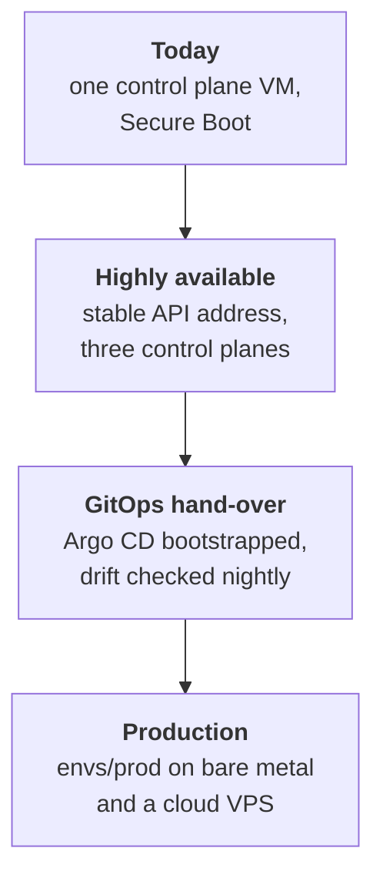

# Roadmap

The `lab` cluster works today, but as a single control plane VM. It proves the pipeline end to end (image, VM, Secure Boot, Talos, Kubernetes) without any redundancy. Next it becomes highly available, hands its apps over to GitOps, and gets a second environment.

The one idea to hold on to: **this repo stops at "the cluster is up".** Everything below either makes that cluster sturdier or gets it ready to hand over to Argo CD.

## Making It Highly Available

With one control plane, a reboot or upgrade takes the whole cluster down. Three control planes keep etcd running when one is away, but they need an address that does not belong to any single node.

- [ ] **Stable API address.** A Talos virtual IP on the LAN or a DNS name for `cluster_endpoint`. This must come first, because the address is built into every node's config.
- [ ] **Three control planes,** choosing per node which ones also run workloads (`allow_workloads`).
- [ ] **Drain before upgrades.** Turn `drain_on_upgrade` back on, so apps move off a node before it reboots. It needs the kubeconfig from a separate step (`kubeconfig_wo`), to avoid a cycle with `talos_cluster_kubeconfig`.

## Handing Over to GitOps

OpenTofu should build the cluster, not manage what runs on it. Once Argo CD is installed, the apps belong to the `k8s-gitops` repo.

- [x] **Argo CD bootstrap** as the last OpenTofu step. From there Argo CD owns everything in `k8s-gitops` (app of apps), and `reset.sh` reinstalls it.
- [ ] **Nightly drift check in CI.** `tofu plan -detailed-exitcode` over Tailscale, with an alert on exit code 2 (changes found). A node changed by hand shows up the next morning.

## A Second Environment

`lab` is where changes are tried. `prod` is where they go once they have worked there.

- [ ] **`envs/prod`.** Bare-metal nodes (`platform = "metal"`) and a cloud VPS, with their own state and passphrase.
- [ ] **Secure Boot keys that survive VM changes.** Any in-place VM change resets the firmware variables, and with them the enrolled keys (see README, Secure Boot). Give the VMs a firmware variables template that already holds the Image Factory keys, so a redefined or recreated VM keeps Secure Boot without a reinstall.
- [ ] **TPM-sealed disk encryption.** A virtual TPM for the VMs (swtpm on the libvirt host), then Talos disk encryption for STATE and EPHEMERAL sealed to it. Secure Boot already proves the boot chain, and this ties the disk keys to it.

## Later

These only matter once more than one machine or site is involved.

- [ ] **Remote state backend** (S3-compatible) once more than one machine runs `tofu`.
- [ ] **A control plane on the VPS** joined through KubeSpan. etcd needs a fast, reliable link between its members, so the quorum should not be stretched over the internet.
